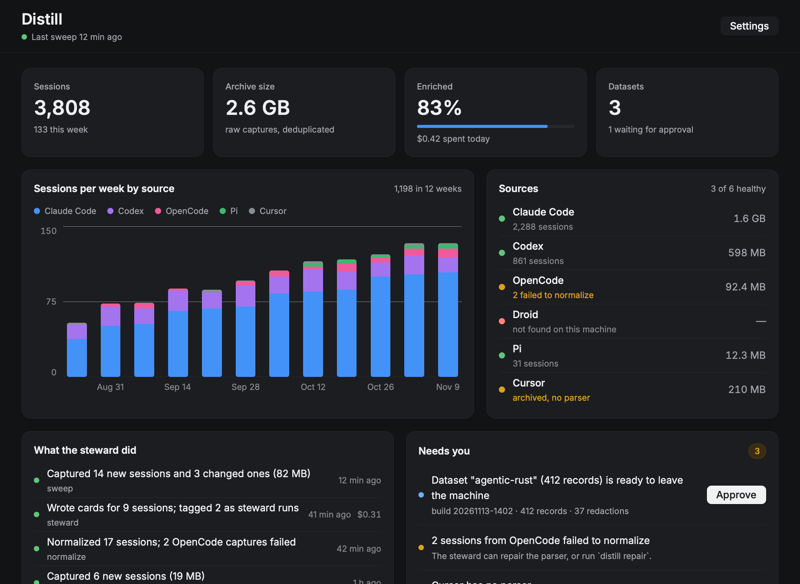

# Distill

Distill passively collects every AI coding-agent session on your machine, keeps the raw bytes forever, and lets agents turn them into data for fine-tuning, evals and personal analysis. You set it up once, glance at a dashboard, and approve anything that leaves the machine.

```
sources ──sweep──▶ raw archive ──steward──▶ derived files ──recipe + redaction + approval──▶ datasets
(Claude Code,      append-only,             meta, events,
 Codex, OpenCode,  content-addressed,       cards; rebuildable
 Droid, Pi,        no model                 at any time
 Cursor, Grok,
 Antigravity,
 Hermes, T3 Code,
 Goose)
```



## Quick start

```sh
cargo build --release
./target/release/distill init          # detect sources, write ~/distill/config.toml
./target/release/distill tick          # sweep, normalize, steward, rebuild datasets
./target/release/distill status
./target/release/distill schedule install   # run `tick` every hour (launchd / systemd)
./target/release/distill gui           # setup and dashboard (build with: cargo build --release -p distill-gui)
```

`DISTILL_HOME` or `--home` moves the home from `~/distill`.

To install `distill`, `distill-mcp` and `distill-gui` into `~/.cargo/bin`, run `scripts/install.sh`. On macOS, run `scripts/setup-signing.sh` once first: it creates a local code-signing certificate in your login keychain (macOS asks for your password to trust it), and `install.sh` signs the binaries with it, so privacy grants like Full Disk Access survive reinstalls. The first signed install still needs the grant once more (the signature changed from cargo's ad-hoc one), and so would a new certificate; keep the one in your keychain. If the timer was installed from `target/release/distill` (the quick start), run `~/.cargo/bin/distill schedule install` once so it runs the installed binary, and grant access to that one.

## What runs where

| Piece | What it does |
| --- | --- |
| `distill sweep` | Copies new and changed session files into `raw/`. A file that only grew replaces its old copy; a rewritten file keeps both. Every file under a source's roots is kept (tool-result files, attachments, settings), compressed Codex sessions included. SQLite files are read through SQLite's backup API; OpenCode sessions and T3 Code threads are exported one per session. Excluded repos are never copied. |
| `distill normalize` | Turns raw captures into `sessions/<source>/<id>/meta.json` and `events.jsonl`: prompts, replies, reasoning, tool calls and tool results. Joins each session to git: commit at start, commits made during it, later reverts. |
| `distill steward run` | Asks an installed harness (`claude -p` or `codex exec`, no tools) to read a digest of each session and answer with a card: task, outcome, quality 1–5, corrections, tags. Distill writes the card; the agent never touches the archive. Stops at the daily budget. |
| `distill recipe propose` | Once a week (or on demand, within the same daily budget or call limit as cards) the steward reads counts of what the archive holds and suggests up to three dataset recipes. Distill keeps the ones that match real sessions in `recipes/proposed/`; `distill recipe proposals` lists them; `distill recipe accept <name>` or the dashboard's Accept turns one into a recipe. Redaction is always on. |
| `distill export build` | Builds each recipe in `recipes/` into `exports/<recipe>/<build>/data.jsonl` with secrets redacted. Same inputs give the same build id and bytes. Builds wait for approval. |
| `distill export approve` / `publish` | Only approved builds can be copied out. |
| `distill import-legacy` | One time: recovers sessions only the earlier Distill kept (`~/.distill`), byte for byte. Only captures whose rebuilt bytes match their recorded hash are imported. |
| `distill-mcp` | Read-only MCP server (stdio): `distill_stats`, `distill_list_sessions`, `distill_read_session`, `distill_search`. |
| `distill-gui` | Native [Rune](https://github.com/anomalyco/rune) window: one-time setup and a dashboard with approvals. |

Add the MCP server to Claude Code with `claude mcp add distill -- /path/to/distill-mcp`.

On macOS, give the `distill` binary Full Disk Access (System Settings → Privacy & Security), or the timer can't read repositories under `~/Desktop`, `~/Documents` or `~/Downloads` to join sessions to git. A launchd job is never shown the permission prompt; without access its git commands block, and Distill kills them after 15 seconds and skips git for that folder until the next run. Reinstalling resets the grant unless the binary is signed with a stable identity (`scripts/install.sh`, above).

Claude Code deletes transcripts older than 30 days by default. Distill sweeps hourly, so it keeps them, but raising `cleanupPeriodDays` in `~/.claude/settings.json` keeps the originals around too.

## Rules for unattended agents

1. The archive is read-only to agents; they only produce derived files, through Distill.
2. Nothing leaves the machine without a human approval.
3. Steward spend is capped per day.
4. Sessions the steward runs are tagged and kept out of datasets.
5. Every run writes to `runs/`, including what failed.

See `docs/plan.md` for the design and `docs/status.md` for what is built.

This replaces the earlier Tauri/Electron Distill (last commit tagged `legacy-final`; `v0.2.0-beta.*` releases). Run `distill import-legacy` once to bring over sessions only it still has.
