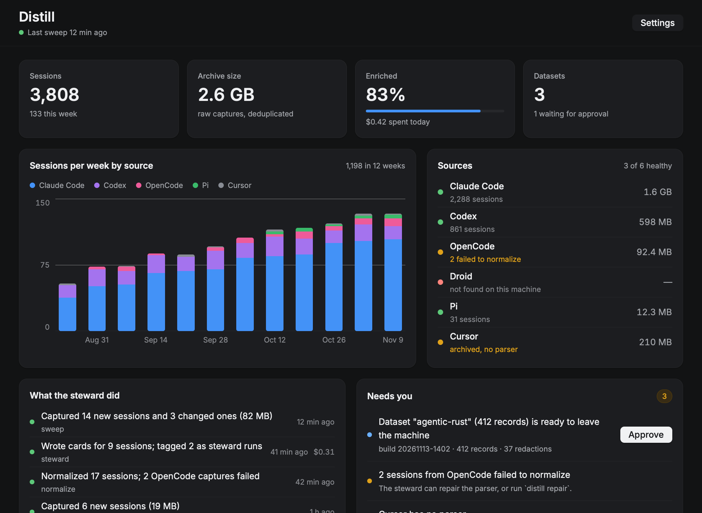

# Distill

Distill passively collects every AI coding-agent session on your machine, keeps the raw bytes forever, and lets agents turn them into data for fine-tuning, evals and personal analysis. You set it up once, glance at a dashboard, and approve anything that leaves the machine.

```
sources ──sweep──▶ raw archive ──steward──▶ derived files ──recipe + redaction + approval──▶ datasets
(Claude Code,      append-only,             meta, events,
 Codex, OpenCode,  content-addressed,       cards; rebuildable
 Droid, Pi,        no model                 at any time
 Cursor)
```



## Quick start

```sh
cargo build --release
./target/release/distill init          # detect sources, write ~/distill/config.toml
./target/release/distill tick          # sweep, normalize, steward, rebuild datasets
./target/release/distill status
./target/release/distill schedule install   # run `tick` every hour (launchd / systemd)
./target/release/distill gui           # setup and dashboard (build with: cargo build --release -p distill-gui)
```

`DISTILL_HOME` or `--home` moves the home from `~/distill`.

## What runs where

| Piece | What it does |
| --- | --- |
| `distill sweep` | Copies new and changed session files into `raw/`. A file that only grew replaces its old copy; a rewritten file keeps both. SQLite sources are read through SQLite's backup API (Cursor) or exported per session (OpenCode). Excluded repos are never copied. |
| `distill normalize` | Turns raw captures into `sessions/<source>/<id>/meta.json` and `events.jsonl`: prompts, replies, reasoning, tool calls and tool results. Joins each session to git: commit at start, commits made during it, later reverts. |
| `distill steward run` | Asks an installed harness (`claude -p` or `codex exec`, no tools) to read a digest of each session and answer with a card: task, outcome, quality 1–5, corrections, tags. Distill writes the card; the agent never touches the archive. Stops at the daily budget. |
| `distill export build` | Builds each recipe in `recipes/` into `exports/<recipe>/<build>/data.jsonl` with secrets redacted. Same inputs give the same build id and bytes. Builds wait for approval. |
| `distill export approve` / `publish` | Only approved builds can be copied out. |
| `distill-mcp` | Read-only MCP server (stdio): `distill_stats`, `distill_list_sessions`, `distill_read_session`, `distill_search`. |
| `distill-gui` | Native [Rune](https://github.com/anomalyco/rune) window: one-time setup and a dashboard with approvals. |

Add the MCP server to Claude Code with `claude mcp add distill -- /path/to/distill-mcp`.

## Rules for unattended agents

1. The archive is read-only to agents; they only produce derived files, through Distill.
2. Nothing leaves the machine without a human approval.
3. Steward spend is capped per day.
4. Sessions the steward runs are tagged and kept out of datasets.
5. Every run writes to `runs/`, including what failed.

See `docs/plan.md` for the design and `docs/status.md` for what is built.

This replaces the earlier Tauri/Electron Distill (last commit tagged `legacy-final`; `v0.2.0-beta.*` releases).
