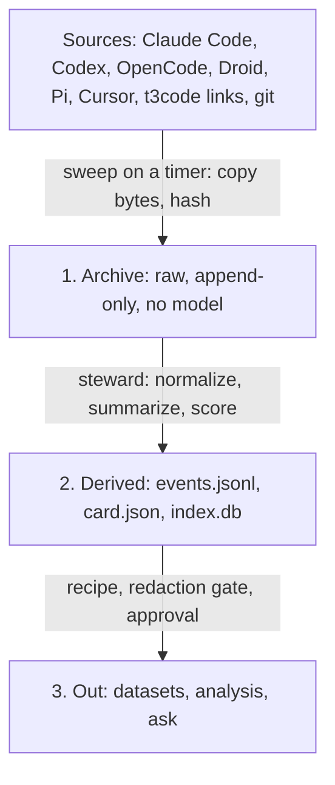

# Distill Rebuild Plan: Agent-Driven Session Archive

- Status: direction agreed 2026-11-13; this repository is that fresh rebuild. `docs/status.md` records what is built against each milestone.
- Predecessor: the Tauri/Electron-era app, replaced in a hard cut. Its last commit is tagged `legacy-final`; its beta releases stay on the releases page.

## Goal

Passively collect every agent session from every harness on the machine, keep it durably, and let agents organize it into data for fine-tuning, evals, and personal analysis. The human sets it up once, glances at a dashboard, and approves anything that leaves the machine.

## Decisions

| Decision | Reason |
| --- | --- |
| Personal tool, not a product | No installers, signing, or release process. |
| Fresh repository | The current repo's governance and desktop shell cost more to unwind than to leave. Adapter and archive code is copied across where it fits. |
| Rust throughout | Chosen 2026-11-13. The existing adapters and capture code are already Rust, so they can be reused instead of rewritten. |
| Files are the truth | Agents read files well. Any database is a cache that can be deleted and rebuilt. |
| Raw archive is separate from everything derived | Raw is the only thing that cannot be recreated. Everything else is re-run when models improve. |
| Full-trajectory fidelity | Training needs tool calls, tool results, system prompts, model and harness version, not only chat text. |
| Agent-driven by default | A steward agent runs on a schedule without being asked. |
| Not its own harness | The steward runs through an installed harness in headless mode (Claude Code or Codex), using existing logins. |
| GUI is a native Rune window | Chosen 2026-11-13. One-time setup plus a read-only dashboard with approvals. Built from source; no installers. |
| Datasets are recipes | A saved query, filter, transform, and redaction pass, rebuilt on demand. Replaces manual train/holdout/exclude lanes. |
| Redaction happens at export | Raw is never scrubbed or edited. |

## Shape



| Layer | Run by | Property |
| --- | --- | --- |
| Archive | Timer | Exact copies. Read-only to agents. |
| Derived | Steward agent | Rebuildable. Every file records the model, prompt, and parser version that produced it. |
| Out | Steward builds, human approves | Nothing leaves the machine without approval. |

## On Disk

```text
~/distill/
  config.toml              one config file; the GUI is a face on it
  raw/                     content-addressed copies of source files
  sessions/
    <source>/<session-id>/
      meta.json            source, model, harness version, repo, git SHA, times
      events.jsonl         normalized trajectory
      card.json            agent-written task, outcome, quality, corrections
  recipes/                 dataset definitions
  exports/                 built datasets, redacted
  runs/                    steward run log
  index.db                 search cache
```

Session files grow while a session is live. A new version that only appends to the previous one replaces it. A version that rewrites earlier bytes (compaction, edits) is kept alongside the old one.

## Components

- **Sweep.** Deterministic, no model. Walks the configured source roots, copies new or changed files into `raw/`, records hashes. Skips excluded repos and paths.
- **Steward.** A scheduled headless agent run with a fixed set of skills: normalize, write cards, join git outcomes, propose and build datasets, verify the archive, report what it could not do.
- **CLI (`distill`).** Sweep, verify, normalize, build a dataset. The steward and the human use the same commands.
- **MCP server.** Search and read sessions from any harness.
- **GUI.** A native window built with Rune, opened by `distill gui`: setup and dashboard. It reads the same files and `config.toml` as everything else and holds no logic of its own.

## Stack

One Rust workspace:

| Crate | Holds |
| --- | --- |
| `distill-core` | Archive, sweep, normalizers, recipes, redaction |
| `distill-cli` | The `distill` binary |
| `distill-mcp` | MCP server |
| `distill-gui` | Setup and dashboard. The only crate that depends on Rune. |

[Rune](https://github.com/anomalyco/rune) is Anomaly's (the OpenCode team's) native GPU-rendered Rust UI framework. As read on 2026-11-13:

- It is pre-release with no stability promise. Depend on a pinned git rev of its `dev` branch.
- Every app can run headless: an agent can render to PNG, dump the element tree, and drive scripted input. That lets agents build and check the GUI themselves.
- Its plan calls text input and IME "the single riskiest area", with native protocols planned rather than built. Setup needs path and number fields, so confirm text fields work before milestone 5.
- Its README and plan mention no chart or table components. The dashboard's sessions-over-time chart may have to be drawn by hand.
- Its plan does not cover packaging. That matches this plan: the GUI is built from source.
- The project does not take pull requests, so a missing piece means waiting or working around it.

Keeping Rune inside `distill-gui`, and the GUI free of logic, is what makes this bet cheap to reverse.

## Setup, One Time

1. **Sources.** Detected automatically; untick any to skip.
2. **Storage.** Where the archive lives.
3. **Agent.** Which installed harness and model runs the steward, and a spend cap.
4. **Privacy.** Repos and paths never to archive. Secret scanning on for exports.
5. **Schedule.** How often to sweep and enrich.

Setup writes `config.toml` and installs the timer.

## Dashboard

Read-only, plus approvals:

- Totals: sessions, archive size, share enriched, datasets built.
- Sessions over time by source.
- Per-source health, including sources with no parser.
- What the steward did (from `runs/`).
- Needs you: exports awaiting approval, parser repairs awaiting approval, failures.

## Rules For Unattended Agents

1. The archive is read-only to agents. They write only derived files.
2. Nothing leaves the machine without a human approval.
3. Spend is capped; the steward stops at the limit.
4. Steward sessions are tagged and kept out of datasets.
5. Every steward run writes a log entry, including what it skipped or failed.

## Against The Current Repository

| Keep | Drop | Add |
| --- | --- | --- |
| Immutable raw captures (ADR 0002) | Tauri desktop app and packaging | Passive sweep on a timer |
| Adapter code in `crates/distill-library/src/adapter/` | Manual label lanes | Steward agent |
| Fixture corpus | Sync leases and the Activity audit trail | Agent-written cards |
| Version stamps on derived data | SQLite as the canonical store | Git outcome signals |
| Restrictive file modes on the home directory | Spec governance and gap register | Dataset recipes, redaction gate, Rune GUI |

## Build Order

Each milestone is done when its exit check passes.

| # | Milestone | Exit check |
| --- | --- | --- |
| 1 | **Capture.** Sweep on a timer over all sources, `config.toml` edited by hand. | Runs unattended for a week; `distill verify` matches every stored hash; a sweep with no source changes writes nothing. |
| 2 | **Use it by hand.** Point agents at the raw archive for real questions. | A written list of at least ten questions asked and what made each slow. That list sets the schema for milestone 3. |
| 3 | **Normalize.** `meta.json` and `events.jsonl`, one source at a time, worst first. | Every archived session of a finished source has events or a recorded failure; normalizer tests run against the real archive. |
| 4 | **Steward.** Scheduled runs, cards, git outcomes, run log. | New sessions get cards within a day with no human action; the spend cap stops a run; steward sessions are tagged. |
| 5 | **GUI.** Setup and dashboard, in Rune. | A clean machine goes from nothing to a running sweep through setup alone; the dashboard matches the files on disk; headless snapshots of each screen are checked in tests. |
| 6 | **Datasets.** Recipes, redaction, export approval. | A recipe rebuilds byte-identically from the same inputs; a planted secret is caught; no export exists without an approval record. |
| 7 | **Agent-repaired parsers.** Steward fixes a parser when a source changes format. | A repair builds, is re-run against the whole archive, and waits for approval before replacing the old parser. |

Milestone 7 is last on purpose: a wrong repair silently produces bad trajectories.

## Measured On This Machine (2026-11-13)

| Source | Size on disk |
| --- | --- |
| Codex (`~/.codex/sessions` and `archived_sessions`) | 16 GB |
| Claude Code (`~/.claude/projects`) | 15 GB |
| Cursor (`~/.cursor`) | 5.1 GB |
| OpenCode (`~/.local/share/opencode`) | 2.8 GB |
| Droid (`~/.factory`) | 1.4 GB |
| Pi (`~/.pi`) | 68 MB |
| Current Distill home (`~/.distill`) | 1.2 GB |

Sizes are whole directories, not only session files.

## Open

- **t3code.** Assumed, not verified, that `~/.t3/userdata/server-owner.sqlite` holds thread, worktree, and PR links worth joining in.
- **Cursor.** No adapter exists; its format has not been examined.
- **Retention.** Check each harness's pruning settings before milestone 1 ships, since pruned sessions are unrecoverable.
- **Repo name.** Not decided.
- **Parser repair in a compiled language.** Parsers compiled into the binary mean a repair is a rebuild and a binary swap, and the steward needs the Rust toolchain. Decide at milestone 7 whether that is acceptable or parsers move to data-driven rules.
- **Rune maturity.** Re-check text input, lists, and the pinned rev when milestone 5 starts.
- **Primary use.** Fine-tuning on trajectories or analysis and evals. Assumed trajectories, which sets the fidelity bar for milestone 3.
